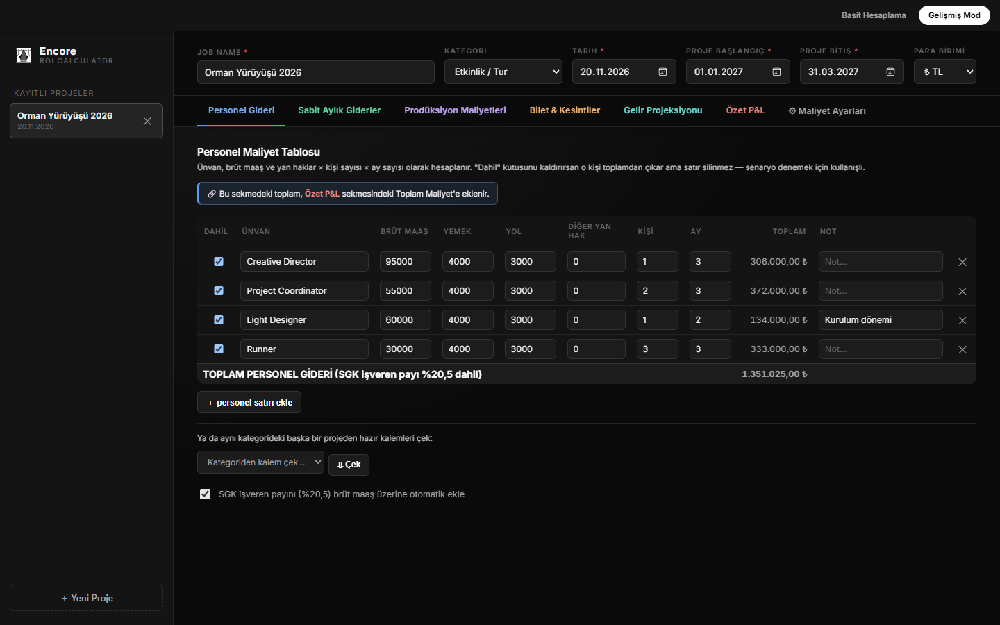
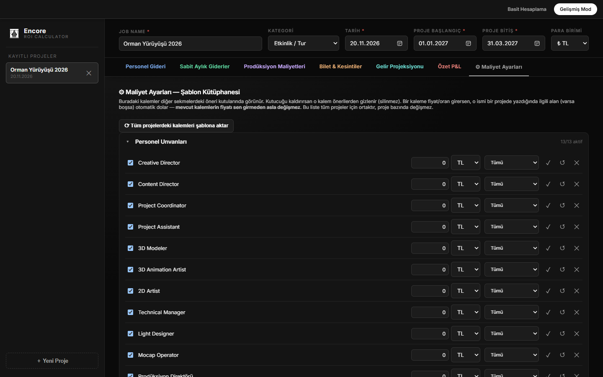

# Encore — Kârlılık & ROI Hesaplayıcı

Encore, etkinlik, sahne gösterisi, festival ve kurumsal aktivite gibi projelerin **maliyet, gelir, kâr marjı ve geri ödeme süresini** hesaplayan bir web uygulamasıdır. Projeler bir **SQLite** veritabanında saklanır ve **Flask** ile yazılmış bir REST API üzerinden yönetilir.

Uygulamanın iki modu var:

- **Basit Hesaplama:** 5 soruda "kârda mıyım?" sorusunu cevaplar.
- **Gelişmiş Mod:** personel, sabit gider, prodüksiyon, bilet kesintileri ve aylık gelir projeksiyonunu ayrıntılı olarak modelleyen, birden çok proje kaydedebilen bir ROI hesaplayıcı.


---

## İçindekiler

- [Özellikler](#özellikler)
- [Ekran Görüntüleri](#ekran-görüntüleri)
- [Kullanılan Teknolojiler](#kullanılan-teknolojiler)
- [Veritabanı Tasarımı](#veritabanı-tasarımı)
- [REST API](#rest-api)
- [Kurulum ve Çalıştırma](#kurulum-ve-çalıştırma)
- [Proje Yapısı](#proje-yapısı)
- [Hesaplama Mantığı](#hesaplama-mantığı)

---

## Özellikler

**Basit mod**
- Adım adım ilerleyen 5 soruluk akış: toplam maliyet, bilet fiyatı, kesinti oranı, satış adedi ve isteğe bağlı hedef kâr marjı
- Satış adedi doğrudan ya da `Gün × Kişi × Seans` formülüyle girilebilir
- Net birim fiyat, toplam gelir, net kâr ve kâr marjı anında hesaplanır
- Sonuç Excel'e aktarılabilir veya tek tıkla Gelişmiş Mod'a yeni proje olarak taşınabilir

**Gelişmiş mod**
- Birden çok projeyi kaydetme, yükleme ve silme (veriler sunucudaki SQLite veritabanında tutulur)
- Yazdıkça otomatik kayıt
- 7 sekme: Personel Gideri, Sabit Aylık Giderler, Prodüksiyon Maliyetleri, Bilet & Kesintiler, Gelir Projeksiyonu, Özet P&L, Maliyet Ayarları
- Personel maliyetlerine SGK işveren payı (%20,5) otomatik eklenebilir
- Kesintiler (KDV, rusum, komisyon, stopaj vb.) tek tek açılıp kapatılabilir
- TL / USD / EUR görüntüleme desteği
- **Şablon kütüphanesi:** sık kullanılan kalemler ve fiyatları kaydedilir, yeni projelerde öneri olarak çıkar
- Aynı kategorideki başka projelerden kalem çekme
- Bütçe teklifi formatında, biçimlendirilmiş ve logolu **Excel çıktısı** (müşteriye gösterilmeyecek gelir/kâr verileri ayrı sayfalarda)
- Mobil uyumlu arayüz

---

## Ekran Görüntüleri

### Basit Hesaplama
Sorular cevaplandıkça bir sonraki açılır. En sonda kâr/zarar sonucu gösterilir.


### Yeni Proje
Proje adı, tarih ve proje tarih aralığı girilmeden hesaplama sekmeleri açılmaz.


### Personel Gideri


### Prodüksiyon Maliyetleri


### Bilet & Kesintiler


### Gelir Projeksiyonu


### Özet P&L


### Maliyet Ayarları (Şablon Kütüphanesi)


---

## Kullanılan Teknolojiler

| Katman | Teknoloji |
|---|---|
| Veritabanı | SQLite (Python `sqlite3` modülü) |
| Backend | Python, Flask |
| Frontend | HTML, CSS, JavaScript (framework kullanılmadı) |
| Excel çıktısı | SheetJS, JSZip, ExcelJS |
| Arka plan animasyonu | WebGL shader |

---

## Veritabanı Tasarımı

Uygulama `encore.db` adında bir SQLite veritabanı kullanır. Veritabanı ve tablo, uygulama ilk çalıştığında otomatik oluşturulur.

```sql
CREATE TABLE IF NOT EXISTS projeler (
    id         TEXT PRIMARY KEY,  -- örn. job_1732272000000_ab12c
    name       TEXT,              -- proje adı
    created_at TEXT,              -- ISO 8601 oluşturulma zamanı
    data       TEXT               -- projenin tüm içeriği (JSON)
);
```

| Sütun | Tip | Açıklama |
|---|---|---|
| `id` | TEXT (PK) | Projenin benzersiz kimliği (istemci tarafında üretilir) |
| `name` | TEXT | Proje adı |
| `created_at` | TEXT | Oluşturulma tarihi. Listeleme bu sütuna göre yeniden eskiye sıralanır |
| `data` | TEXT | Personel, gider, kesinti ve gelir satırlarının tamamı JSON olarak |

**Tasarım kararı:** Bir projenin alt kalemleri (personel satırları, prodüksiyon kategorileri, kesintiler, gelir ayları) değişken sayıda ve yapıdadır. Bu yüzden sorgulanan alanlar (`id`, `name`, `created_at`) ayrı sütunlarda tutuluyor, projenin geri kalanı tek bir JSON belgesi olarak `data` sütununda saklanıyor. Kayıt işlemi `INSERT OR REPLACE` ile yapıldığı için aynı `id` ile gelen istek mevcut kaydı günceller. Tüm sorgularda SQL enjeksiyonuna karşı parametreli sorgu (`?`) kullanılır.

---

## REST API

| Metot | Uç Nokta | Açıklama |
|---|---|---|
| `GET` | `/api/projeler` | Tüm projeleri yeniden eskiye sıralı döndürür |
| `POST` | `/api/projeler` | Projeyi ekler, aynı `id` varsa günceller |
| `DELETE` | `/api/projeler/<proje_id>` | Projeyi siler |

**Örnek istek:**

```bash
curl -X POST http://localhost:5001/api/projeler \
  -H "Content-Type: application/json" \
  -d '{"id": "job_1", "name": "Orman Yürüyüşü 2026", "createdAt": "2026-11-20T10:00:00Z"}'
```

```json
{"durum": "kaydedildi"}
```

`id` alanı olmayan bir istek `400` döner:

```json
{"hata": "proje id'si gerekli"}
```

---

## Kurulum ve Çalıştırma

Gereksinim: **Python 3.9+**

```bash
git clone https://github.com/Bovery-Max/Encore.git
cd Encore

python -m venv venv
# Windows
venv\Scripts\activate
# macOS / Linux
source venv/bin/activate

pip install -r requirements.txt
python app.py
```

Ardından tarayıcıda **http://localhost:5001** adresini açın. `encore.db` dosyası ilk çalıştırmada proje klasöründe otomatik oluşturulur.

> Excel kütüphaneleri ve yazı tipleri CDN'den yüklendiği için internet bağlantısı gerekir.

---

## Proje Yapısı

```
Encore/
├── app.py                  # Flask uygulaması, SQLite bağlantısı ve REST API
├── requirements.txt        # Python bağımlılıkları
├── static/
│   ├── index.html          # Tek sayfalık arayüz (iki mod)
│   ├── css/style.css       # Tüm stiller (koyu tema)
│   └── js/
│       ├── simple-mode.js    # Basit hesaplama akışı ve Excel çıktısı
│       ├── advanced-mode.js  # Gelişmiş mod: durum, hesaplamalar, sekmeler, API çağrıları
│       ├── excel-export.js   # Bütçe teklifi formatında Excel çıktısı
│       └── shader-bg.js      # Basit mod arka plan animasyonu (WebGL)
└── docs/screenshots/       # README görselleri
```

---

## Hesaplama Mantığı

| Değer | Formül |
|---|---|
| Personel gideri | Σ (brüt + yemek + yol + diğer yan hak) × kişi × ay, SGK dahilse + brüt toplamın %20,5'i |
| Sabit gider | Aylık sabit gider toplamı × proje süresi (ay) |
| Prodüksiyon gideri | Σ adet × gün × birim fiyat |
| **Toplam maliyet** | Personel + Sabit + Prodüksiyon |
| Net bilet fiyatı | Brüt fiyat − Σ (brüt fiyat × işaretli kesinti oranı) |
| Bilet geliri | Σ çalışma günü × seans/gün × kapasite × doluluk % × net bilet fiyatı |
| **Proje bedeli** | Bilet geliri + diğer gelirler (veya elle girilen tutar) |
| **Kâr** | Proje bedeli − Toplam maliyet |
| **Kâr marjı** | Kâr / Proje bedeli × 100 |
| **Geri ödeme süresi** | Yatırım tutarı / (Kâr / proje süresi) |

Proje süresi, başlangıç ve bitiş tarihleri arasındaki gün sayısının 30,44'e bölünmesiyle ay cinsinden bulunur.

---

## Geliştirici

**[Bovery-Max](https://github.com/Bovery-Max)**: Veritabanı Sistemleri dersi projesi
