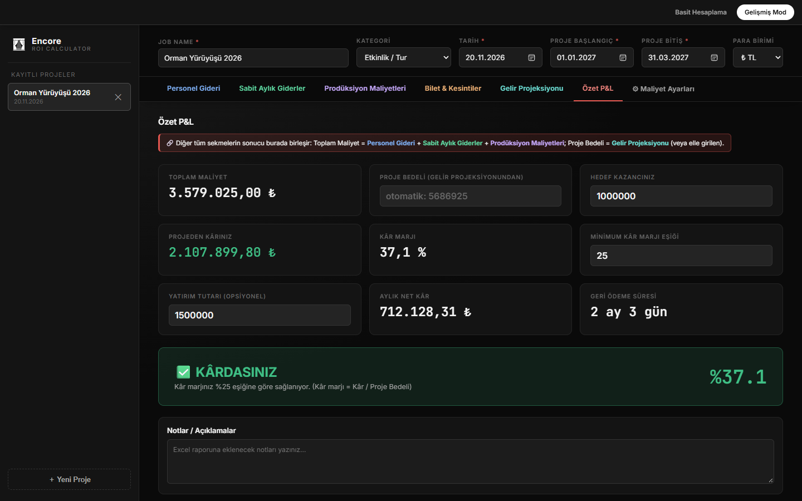
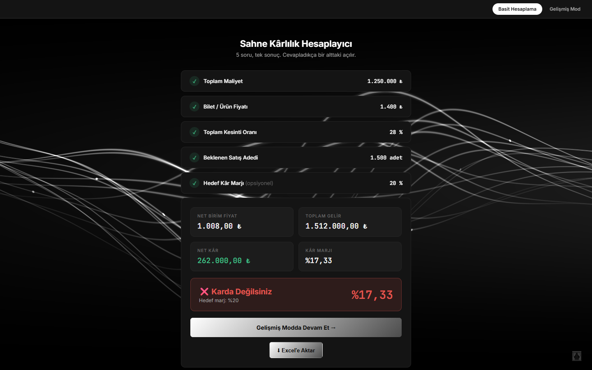
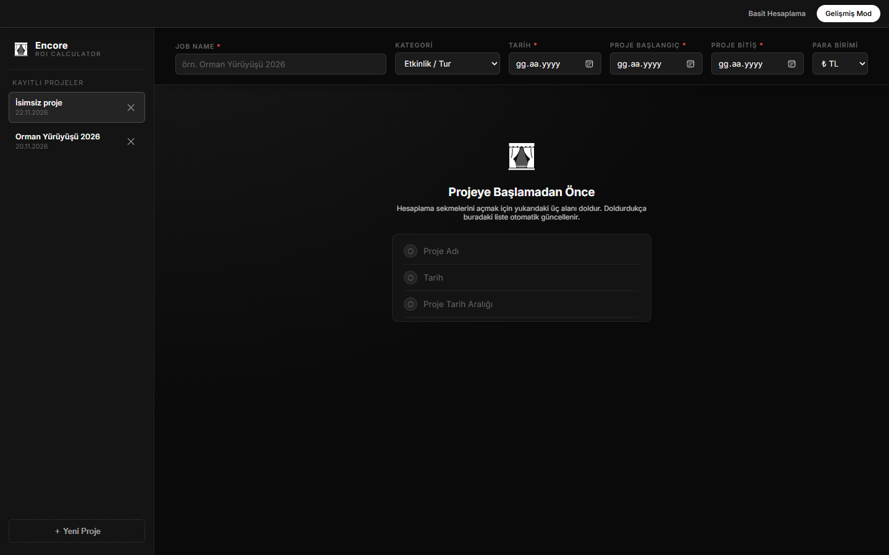
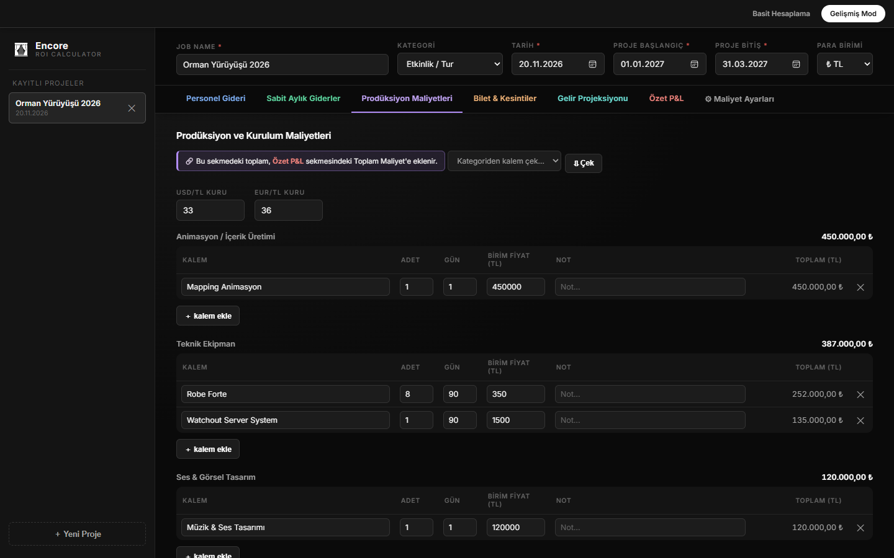
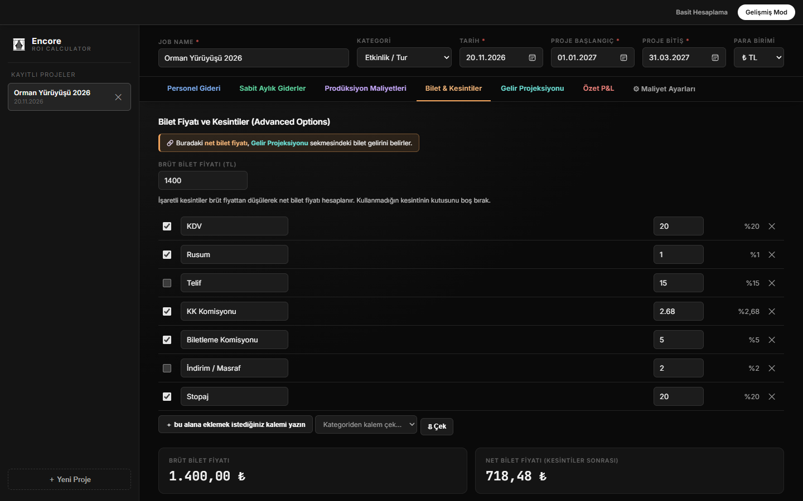
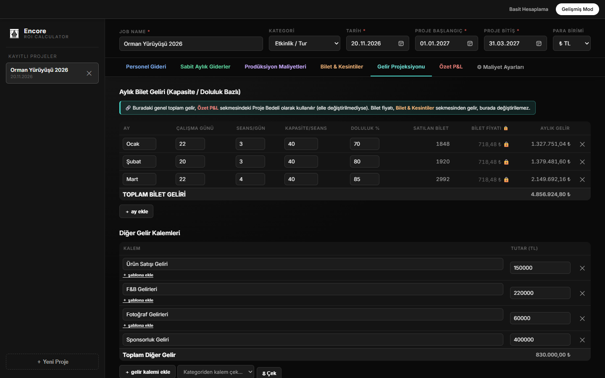

# Encore — Profitability & ROI Calculator

Encore is a web application that calculates the **cost, revenue, profit margin and payback period** of projects such as events, stage shows, festivals and corporate activities. Projects are stored in a **SQLite** database and managed through a REST API built with **Flask**.

The application has two modes:

- **Simple Calculation:** answers "am I making a profit?" in 5 questions.
- **Advanced Mode:** a multi-project ROI calculator that models personnel, fixed costs, production, ticket deductions and monthly revenue projections in detail.

> The user interface is in Turkish.



---

## Table of Contents

- [Features](#features)
- [Screenshots](#screenshots)
- [Tech Stack](#tech-stack)
- [Database Design](#database-design)
- [REST API](#rest-api)
- [Security](#security)
- [Installation & Running](#installation--running)
- [Project Structure](#project-structure)
- [Calculation Logic](#calculation-logic)

---

## Features

**Simple mode**
- Step-by-step 5-question flow: total cost, ticket price, deduction rate, sales quantity and an optional target profit margin
- Sales quantity can be entered directly or with the `Days × People × Sessions` formula
- Net unit price, total revenue, net profit and profit margin are calculated instantly
- Results can be exported to Excel or moved to Advanced Mode as a new project with one click

**Advanced mode**
- Save, load and delete multiple projects (data is stored in the server-side SQLite database)
- Autosave while typing
- 7 tabs: Personnel Costs, Fixed Monthly Costs, Production Costs, Tickets & Deductions, Revenue Projection, Summary P&L, Cost Settings
- Employer social security contribution (SGK, 20.5%) can be added to personnel costs automatically
- Deductions (VAT, municipal tax, commissions, withholding tax, etc.) can be toggled individually
- Display in TRY / USD / EUR
- **Template library:** frequently used items and their prices are saved and suggested in new projects
- Pull items from other projects in the same category
- Formatted **Excel export** with logo in a budget-proposal layout (internal revenue/profit data that should not be shown to the client is kept on separate sheets)
- Mobile-friendly interface

---

## Screenshots

### Simple Calculation
Each question opens after the previous one is answered. The profit/loss result is shown at the end.



### New Project
The calculation tabs stay locked until the project name, date and project date range are entered.



### Personnel Costs


### Production Costs


### Tickets & Deductions


### Revenue Projection


### Summary P&L


### Cost Settings (Template Library)


---

## Tech Stack

| Layer | Technology |
|---|---|
| Database | SQLite (Python `sqlite3` module) |
| Backend | Python, Flask |
| Frontend | HTML, CSS, JavaScript (no framework) |
| Excel export | SheetJS, JSZip, ExcelJS |
| Background animation | WebGL shader |

---

## Database Design

The application uses a SQLite database named `encore.db`. The database and table are created automatically on first run.

```sql
CREATE TABLE IF NOT EXISTS projeler (
    id         TEXT PRIMARY KEY,  -- e.g. job_1732272000000_ab12c
    name       TEXT,              -- project name
    created_at TEXT,              -- ISO 8601 creation time
    data       TEXT               -- full project content (JSON)
);
```

| Column | Type | Description |
|---|---|---|
| `id` | TEXT (PK) | Unique project identifier (generated on the client) |
| `name` | TEXT | Project name |
| `created_at` | TEXT | Creation date. Projects are listed newest first by this column |
| `data` | TEXT | All personnel, cost, deduction and revenue rows as JSON |

**Design decision:** A project's sub-items (personnel rows, production categories, deductions, revenue months) vary in number and structure. So the queried fields (`id`, `name`, `created_at`) live in their own columns, and the rest of the project is stored as a single JSON document in the `data` column. Saving uses `INSERT OR REPLACE`, so a request with an existing `id` updates that record. All queries use parameterized statements (`?`) to prevent SQL injection.

---

## REST API

| Method | Endpoint | Description |
|---|---|---|
| `GET` | `/api/projeler` | Returns all projects, newest first |
| `POST` | `/api/projeler` | Creates a project, or updates it if the `id` already exists |
| `DELETE` | `/api/projeler/<proje_id>` | Deletes a project |

**Example request:**

```bash
curl -X POST http://localhost:5001/api/projeler \
  -H "Content-Type: application/json" \
  -d '{"id": "job_1732272000000_ab12c", "name": "Forest Walk 2026", "createdAt": "2026-11-20T10:00:00Z"}'
```

```json
{"durum": "kaydedildi"}
```

An invalid request returns `400`:

```json
{"hata": "geçersiz proje verisi"}
```

---

## Security

| Threat | Mitigation |
|---|---|
| SQL injection | All queries are parameterized (`?`) |
| XSS (script execution from stored data) | Every value coming from data is escaped before being written to HTML (`escAttr`). Inline event handlers only receive numeric indexes, never user data |
| Malformed / malicious data | Server-side schema validation: `id` format (`job_<timestamp>_<random>`), field types, string length, nesting depth; prototype keys such as `__proto__` are rejected |
| Overloading the service with large requests | Request size limited to 1 MB (`413`) |
| CSRF (another site calling the API) | `Sec-Fetch-Site` header is checked; only JSON is accepted |
| DNS rebinding | Only `localhost` / `127.0.0.1` Host headers are accepted (`TRUSTED_HOSTS`) |
| Clickjacking, data exfiltration | `Content-Security-Policy` (`frame-ancestors 'none'`, `connect-src 'self'`), `X-Frame-Options`, `nosniff`, `no-referrer` |
| Tampered CDN libraries | Subresource Integrity (`integrity` hash) on external scripts |
| Code execution through the debug console | Debug mode is off by default and only enabled with `ENCORE_DEBUG=1`. The server only listens on `127.0.0.1` |

To run the tests (they do not touch the real database):

```bash
python test_app.py
```

---

## Installation & Running

Requirement: **Python 3.9+**

```bash
git clone https://github.com/Bovery-Max/Encore.git
cd Encore

python -m venv venv
# Windows
venv\Scripts\activate
# macOS / Linux
source venv/bin/activate

pip install -r requirements.txt
python app.py
```

Then open **http://localhost:5001** in your browser. The `encore.db` file is created automatically in the project folder on first run.

> An internet connection is required because the Excel libraries and fonts are loaded from a CDN.

---

## Project Structure

```
Encore/
├── app.py                  # Flask app, SQLite connection and REST API
├── test_app.py             # API and security tests
├── requirements.txt        # Python dependencies
├── static/
│   ├── index.html          # Single-page interface (both modes)
│   ├── css/style.css       # All styles (dark theme)
│   └── js/
│       ├── simple-mode.js    # Simple calculation flow and Excel export
│       ├── advanced-mode.js  # Advanced mode: state, calculations, tabs, API calls
│       ├── excel-export.js   # Budget-proposal Excel export
│       └── shader-bg.js      # Simple mode background animation (WebGL)
└── docs/screenshots/       # README images
```

---

## Calculation Logic

| Value | Formula |
|---|---|
| Personnel cost | Σ (gross salary + meal + transport + other benefits) × people × months, plus 20.5% of total gross salary if SGK is included |
| Fixed cost | Total monthly fixed costs × project duration (months) |
| Production cost | Σ quantity × days × unit price |
| **Total cost** | Personnel + Fixed + Production |
| Net ticket price | Gross price − Σ (gross price × selected deduction rate) |
| Ticket revenue | Σ working days × sessions/day × capacity × occupancy % × net ticket price |
| **Project value** | Ticket revenue + other revenue (or a manually entered amount) |
| **Profit** | Project value − Total cost |
| **Profit margin** | Profit / Project value × 100 |
| **Payback period** | Investment amount / (Profit / project duration) |

Project duration in months is the number of days between the start and end dates divided by 30.44.

---

## Developer

**[Bovery-Max](https://github.com/Bovery-Max)**: Database Systems course project
